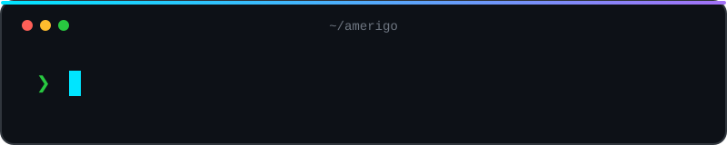

  

  

    
    
    
    
    
    
    
  

  
<strong>Founder in Munich · M.Sc. Robotics, Cognition, Intelligence @ TUM · Previously fyndl</strong>

## 👨‍💻 About Me

I'm Amerigo, a founder and M.Sc. student in Munich. I study **Robotics, Cognition, Intelligence at TUM**, build local-first AI tools and software end-to-end, and co-founded the **EuroTech Federation**. Most recently I built **fyndl**, an AI search engine for secondhand electronics, as a **Gründerszene Fellow** with Axel Springer. Before that I worked in transfer pricing at **EY** and on the IT service desk at **univativ**, supporting BayernLB.

I like systems that are fast, explainable and useful in the real world: a Rust motion planner that runs in the browser, a search engine for your own photos, or a tool that catches stale instructions in an AI agent's config. The common thread is turning a fuzzy problem into something deterministic, testable and easy to operate.

- 🔭 **Currently working on:** [Velletti Consulting](https://ame.velletti.de/) (AI, automation, web and DevOps) and the [EuroTech Federation](https://www.eurotech-federation.com/) platform and IT.
- 🎓 **Studying:** M.Sc. Robotics, Cognition, Intelligence at TUM.
- 🌱 **Currently learning:** robot motion planning, spatial reasoning, local-first AI and reliable distributed systems.
- 👯 **Looking to collaborate on:** local-first AI, robotics, developer tools and European tech communities.
- 💬 **Ask me about:** Rust, Python, TypeScript, RAG, vector search, Docker, Linux and turning an idea into a working prototype.
- 🏅 **Highlights:** TRACE accepted at CoopIS 2026 (sole author) · Gründerszene Fellow (one of 8) · EuroTech Federation Co-Founder · Enactus World Cup with Evolve.
- 📫 **How to reach me:** [portfolio@ame.velletti.de](mailto:portfolio@ame.velletti.de)

## 🚀 Selected Work

### Robotics & research

- **[motionAmigo](https://github.com/Amerigo2020/motionAmigo)** · SIMD-vectorized sampling-based motion planner for robot arms in Rust, with Python bindings and a WebAssembly demo. Plans for the Franka Panda and UR5, with a median planning time of 119 µs on 699 MotionBenchMaker problems. [Live demo](https://amerigo2020.github.io/motionAmigo/)
- **[spatialAmigo](https://github.com/Amerigo2020/spatialAmigo)** · Deterministic, explainable resolution of spatial referring expressions in 3D scenes. Rust core, Python bindings and a WebAssembly demo, with a trace for every decision. [Live demo](https://amerigo2020.github.io/spatialAmigo/)
- **[TRACE](https://avelletti.de/en/projects/trace.html)** · Sole-author paper accepted at CoopIS 2026: hybrid retrieval and deterministic tool orchestration for auditable AI compliance systems. Grew out of my bachelor's thesis at TUM and my work at EY.

### AI & local-first

- **[mediaAmigo](https://github.com/Amerigo2020/mediaAmigo)** · Local AI search for photos, videos and documents with OpenCLIP, multilingual E5, Whisper, SQLite and Qdrant. MIT-licensed CLI alpha.
- **[emailAmigo](https://avelletti.de/en/projects/emailamigo.html)** · Local multi-account email workspace with a unified inbox, SQLite FTS5 search and explicit, account-bound actions.
- **[CarbonMatch](https://github.com/Amerigo2020/vestigas-co2-scribe)** · Embedding-based pipeline that matches construction deliveries to CO2e factors for CSRD reporting, using Azure OpenAI embeddings.

### Developer tools

- **[lintamigo](https://github.com/Amerigo2020/lintamigo)** · Catches stale paths, dead commands and credential-shaped values in CLAUDE.md, AGENTS.md, Cursor rules and Copilot instructions. No LLM required. On [npm](https://www.npmjs.com/package/lintamigo).
- **[applyAmigo](https://github.com/Amerigo2020/applyAmigo)** · Finds relevant opportunities, prepares evidence-based applications and manages an application sprint. React 19, Next.js and Cloudflare D1.
- **[amerigo-codex-skills](https://github.com/Amerigo2020/amerigo-codex-skills)** · A small skill pack for Codex and similar agents: humanizer, docs-audit and project-planner.
- **[DemoAmigo](https://github.com/Amerigo2020/DemoAmigo)** · An agent skill that turns a freshly built project into a short, shareable launch and demo package.

### Products & ventures

- **[fyndl](https://fyndl.online/)** · AI search engine that unifies secondhand and refurbished electronics in one comparable view. Built in the Gründerszene Fellowship with Axel Springer.
- **[Evolve](https://evolve-insekten.de/)** · Co-founded through Enactus: turns brewery waste into insect protein. Represented Germany at the Enactus World Cup in Bangkok.
- **[Velletti Consulting](https://ame.velletti.de/)** · My home for software, AI automation, web and DevOps projects.
- **[EuroTech Federation](https://www.eurotech-federation.com/)** · Co-founded a pan-European community for deep-tech builders, founders and researchers. I work on the platform and IT.

### Creator & web

- **[openTeleprompter](https://github.com/Amerigo2020/openTelepromter)** · Free teleprompter for Windows, Linux and the browser, with speech-based word tracking. [Web app](https://amerigo2020.github.io/openTelepromter/).
- **[LensGuard](https://github.com/Amerigo2020/ContactLensesApp)** · Flutter and Firebase app for contact lens wearers with wear-time tracking and daily reminders.
- **[PNG to SVG Converter](https://github.com/Amerigo2020/Picture_to_SVG_Konverter)** · Converts PNG, JPG, WebP and BMP images to SVG with contour tracing and batch mode.
- **[AmigoComingSoon](https://github.com/Amerigo2020/AmigoComingSoon)** · Bilingual (DE/EN) animated coming-soon page for client websites, built with React 18 and Vite.
- **[Publisher-Plattformen: Founder to CFO](https://github.com/Amerigo2020/publisher-platformen-cfo)** · Interactive decision map for affiliate networks, publishers and merchants. [Live page](https://amerigo2020.github.io/publisher-platformen-cfo/).

More experiments, forks and older work: [all public repositories](https://github.com/Amerigo2020?tab=repositories).

## 🛠️ Tech Stack

**Languages**

**Frameworks & infrastructure**

**AI & data**

**Robotics & systems**

## 💼 Beyond Code

- **Entrepreneurship:** Built Fyndl, co-founded Evolve and the EuroTech Federation, and run Velletti Consulting.
- **Community:** EuroTech Federation core team, Hackathon Hub Ambassador, Enactus München Relations Lead, EuroTech Week organizer and EuroTeQ Summer Games participant.
- **Communication:** Pitches, demos and articles for Gründerszene; comfortable explaining technical work to mixed audiences.
- **Mentoring:** Mentored students across three countries and spent 14 years in the Münchner Domchor, later as a point of contact for younger singers.
- **Systems thinking:** From IT service desk and Linux/VPS operations to APIs, data models and UIs.
- **Languages:** German, English and Italian.

<strong>Experience & education</strong>

**Experience**

- Fellow, Gründerszene (Jul 2026 to present)
- Founding Engineer, stealth startup (Apr 2026 to May 2026)
- Self-employed, Velletti Consulting (Jul 2025 to present)
- Transfer Pricing, EY (Mar 2025 to Apr 2026)
- IT Service Desk, univativ, supporting BayernLB (Feb 2024 to Dec 2024)
- Intern, Jörg Velletti EDV Service (Feb 2020 to Feb 2024)

**Education**

- M.Sc. Robotics, Cognition, Intelligence, TUM
- B.Sc. Wirtschaftsinformatik, TUM
- Abitur, Gymnasium Fürstenried West

**Volunteering**

- Co-Founder and Core Team, EuroTech Federation
- Relations Lead, Enactus München
- Webpage and Business Development, Evolve
- Hackathon Hub Ambassador

## 📝 Latest Writing

- [How AI Automation Saves Startups 20+ Hours Per Week](https://ame.velletti.de/blog/post.php?slug=ai-automation-for-startups) · 11 Apr 2026
- [Vibecoding: When It Works, When It Breaks, and How to Do It Right](https://ame.velletti.de/blog/post.php?slug=vibecoding-when-it-works-when-it-breaks) · 11 Apr 2026
- [CI/CD for Small Teams: Ship Without Fear in Under a Day](https://ame.velletti.de/blog/post.php?slug=cicd-for-small-teams) · 10 Apr 2026
- [CSRF Protection: The Attack Every Web Developer Should Understand](https://ame.velletti.de/blog/post.php?slug=csrf-protection-explained) · 10 Apr 2026
- [Context Windows: What Developers Get Wrong About AI Coding Assistants](https://ame.velletti.de/blog/post.php?slug=context-windows-what-developers-get-wrong) · 9 Apr 2026

[Read more on the Velletti Consulting blog →](https://ame.velletti.de/blog/)

## 📰 In the Press

- [From a green "F" to a 3D fox](https://www.businessinsider.de/gruenderszene/gruenderszene-sucht-die-super-gruender/vom-gruenen-f-zum-3d-fuchs-so-entstand-das-logo-der-secondhand-app-fyndl/) · Gründerszene, 17 Aug 2026
- [From coder to salesperson](https://www.businessinsider.de/gruenderszene/gruenderszene-sucht-die-super-gruender/fellows/vom-coder-zum-verkaeufer-wenn-gruender-ueber-ihren-schatten-springen/) · Gründerszene, 6 Aug 2026
- [Why even founders should sometimes finish work earlier](https://www.businessinsider.de/gruenderszene/warum-selbst-gruender-manchmal-frueher-feierabend-machen-sollten/) · Gründerszene, 27 Jul 2026
- [A 21-year-old wants to build the "Idealo for secondhand"](https://www.businessinsider.de/gruenderszene/gruenderszene-sucht-die-super-gruender/fellows/21-jaehriger-will-das-idealo-fuer-secondhand-bauen/) · Gründerszene, 14 Jul 2026
- [Höhle des Lindners: a conversation about Fyndl](https://de.linkedin.com/posts/gr%C3%BCnderszene_h%C3%B6hle-des-lindners-mit-fyndl-baut-supergr%C3%BCnder-fellow-activity-7500538837543051264-cAYJ) · Gründerszene video
- [Launch of the Gründerszene startup summer camp](https://www.axelspringer.com/de/ax-press-release/start-des-gruenderszene-startup-sommercamps-premium-gruppe-schmiedet-ki-oekosystem-mit-openai-vercel-dash0-und-dhl) · Axel Springer, 9 Jul 2026

[All articles and press →](https://avelletti.de/en/articles/)

## 📊 GitHub Stats

  

  

  

## 📈 Contribution Graph

  

## 📫 Contact Me

- **Website:** [avelletti.de](https://avelletti.de)
- **Email:** [portfolio@ame.velletti.de](mailto:portfolio@ame.velletti.de)
- **LinkedIn:** [Amerigo Velletti](https://www.linkedin.com/in/amerigo-velletti/)
- **GitHub:** [@Amerigo2020](https://github.com/Amerigo2020)
- **X:** [@AmerigoVelletti](https://x.com/AmerigoVelletti)
- **Hugging Face:** [AmerigoVelletti](https://huggingface.co/AmerigoVelletti)
- **ORCID:** [0009-0006-7886-2913](https://orcid.org/0009-0006-7886-2913)

  Munich, Germany · Always happy to meet curious people.

